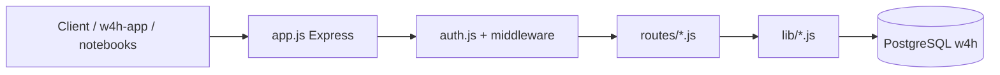

# AGENTS.md — w4h-api

Agent playbook for the **Wearables for Health (W4H) Toolkit** HTTP API: Node.js (ESM), Express 4, PostgreSQL (`w4h` schema). Human-oriented setup: [README.md](./README.md). Structural API map: [API_INDEX.md](./API_INDEX.md) (generated). The shared W4H architecture overview (all repos, concepts, flows) is at the end of this file.

## Where this repo fits in W4H

`w4h-api` is the **hub**. Every other repo either calls it, is executed by it, or is imported by it:

| Relationship | Repos | Mechanism here |
|---|---|---|
| Calls it with a JWT | `w4h-app` | `POST /users/login`, then every UI request |
| Calls it with a personal API key (`w4h_sk_…`) | Importers, `w4h-sql-compute-mets` notebook/CLI, any researcher notebook | `authenticateJwtOrApiKey` routes |
| Executed by it as a subprocess | `runnable` Python contributions (`run.sh` in a sibling checkout) | `lib/contribution-runner.js` |
| Executed by it in-process | `kind: sql` contributions (sibling `manifest.yaml` + `sql/*.sql`) | `lib/sql-contribution-engine.js` |
| Imported by it | `w4h-docs` markdown → `w4h.docs`; media at `/docs-media` | `DOCS_REPO_PATH`, `bin/w4h`, `lib/utils/docs.js` |
| Packaged by | `w4h-docker` (`api` image: `node:22`, **no Python**, docs baked at `/w4h-docs`) | `W4H_ENV_FILE=/app/persist/.env` |
| Bypasses it | `fft_approximate` (Postgres extension) and `w4h-demo-approximate-queries` (direct `psycopg2`) | none |

**Code that owns each platform flow:**

| Flow | Route | Library |
|---|---|---|
| CSV ingest | `POST /datasets/:id/import/csv-batch` | `lib/ingest-csv.js`: ACL (`assertCanIngestDataset`), `ds_<id>` schema, `<prefix>_<signal>` table, `w4h.tables` upsert |
| Signal discovery | `GET /datasets/:id/signals` | `lib/sql-contribution-engine.js` |
| In-app Run | `POST /contributions/:slug/run`, `GET /contributions/runs/:id` | `lib/contribution-runner.js` (clone/fast-forward sibling, spawn `run.sh`, parse `@@PROGRESS@@`, write `w4h.contribution_runs`, refresh summary) |
| SQL analytics | `POST /datasets/:id/contributions/:slug/sql` | `lib/sql-contribution-engine.js` (bind identifiers from `w4h.tables`, execute, materialize new table) |
| Contributions catalog | `/contributions/*` | `lib/contributions.js`; seed rows + `runnable` flags in `data/schema.sql` |
| Cohort / chart analytics | `/datasets/:id/analytics/*` | `lib/cohort-analytics.js`, `lib/viz-queries.js` |

Because the runner and SQL engine read sibling folders (`CONTRIBUTION_RUNNER_REPO_ROOT`, default `..`), in-app Run only works when contribution repos can live next to this checkout, and on a host with Python. The Docker image has no Python, so in-app Run of importers there is designed but not built (ADR-022, MVP D-31).

## Table of contents

1. [What this repo is / is not](#what-this-repo-is--is-not)
2. [Commands](#commands)
3. [Local development](#local-development)
4. [Architecture](#architecture)
5. [Authentication and authorization](#authentication-and-authorization)
6. [Where to put code](#where-to-put-code)
7. [Implementation conventions](#implementation-conventions)
8. [Playbooks (common tasks)](#playbooks-common-tasks)
9. [Validation checklist](#validation-checklist)
10. [Security and compliance](#security-and-compliance)
11. [Hard boundaries](#hard-boundaries)
12. [Product and ADR pointers](#product-and-adr-pointers)
13. [Sibling repositories](#sibling-repositories)
14. [Git and PR expectations for agents](#git-and-pr-expectations-for-agents)
15. [W4H system overview (shared across all repos)](#w4h-system-overview-shared-across-all-repos)

---

## What this repo is / is not

**Is:**

- REST API for teams, projects, datasets, contributions catalog, in-app docs, platform config, and AI chat proxies.
- PostgreSQL DDL in `data/*.sql`, applied via `ensureSchema` on startup when DB env is set.
- CLI for break-glass and fixtures: `bin/w4h`.

**Is not:**

- The Vue web UI (`w4h-app`), product prose (`w4h-docs` — but docs are **imported** from there when `DOCS_REPO_PATH` is set).
- Contribution **implementations** (Python/notebook repos); this repo **runs** and **catalogs** them.
- Docker/production deploy definitions (`w4h-docker` owns API image/compose).

**Tenancy model (API-relevant):** **Team** = tenancy. **Project** = primary access unit. Platform **super admin** is account-wide; team/project authority comes from memberships (`owner` / `editor` / `viewer`). No `project_notebooks` — use **Contributions** (ADR-018).

---

## Commands

Run from repository root (`w4h-api/`).

| Command | Purpose |
|---------|---------|
| `npm install` | Install dependencies |
| `npm start` | Run API (`app.js`, `PORT` from `.env`, default **2026**) |
| `npm run start:sample` | API against DB `w4h-sample` |
| `npm run index:api` | Regenerate `API_INDEX.md` after route/mount changes |
| `npm test` | **Stub only** — does not run real tests |
| `node --test lib/sql-ident.test.js` | The one unit-test file (identifier validation/quoting used by ingest and the SQL engine) |
| `node scripts/smoke-test-csv-batch-insert.mjs` | Self-check of the `csv-batch` insert path against the `.env` database; creates and drops its own scratch dataset |
| `node scripts/ensure-user-projects.mjs` | One-off repair: creates/backfills legacy `w4h.user_projects` on older databases |
| `node bin/w4h` | CLI help |
| `node bin/w4h configuration` | Print DB connection from env |
| `node bin/w4h seed-docs` | Seed **`w4h-sample`** DB (does not touch `DB_DATABASE`) |
| `node bin/w4h reset-password` | Break-glass admin password reset (document per HIPAA process) |

**Debug:** set `W4H_DEBUG=true` in `.env` for verbose DB logging on boot.

**Env file location:** `lib/env-path.js` — default `<repo>/.env`; override with `W4H_ENV_FILE` (Docker uses `/app/data/.env`).

---

## Local development

```bash
cp .env.example .env
npm install
npm start
```

- **First-time DB setup:** leave `DB_USER` / `DB_PASSWORD` / `TOKEN_SECRET` empty and use `/config/*` flows, or set Postgres vars and restart. To repeat bootstrap, **unset** `DB_DATABASE` in `.env` (see README).
- **Docs import:** `DOCS_REPO_PATH=../w4h-docs` (default in `.env.example`). Fixtures: `w4h-docs/dev/docs-fixtures.md`.
- **Postgres.app (macOS):** if you see `Postgres.app rejected "trust" authentication`, allow **`node`** in Postgres.app → Preferences → permissions (see README).
- **Smoke auth:** `examples/python/user_api_key_client.py`, `project_db_token_client.py`; login via `POST /users/login`.

**VS Code:** `.vscode/launch.json` — launch `app.js` or `bin/w4h`.

---

## Architecture



**Request path:**

1. `app.js` — CORS, JSON body (10mb), `attachApiKeyUsageLogger`, static `public/`, optional `/docs-media` from `DOCS_REPO_PATH`.
2. Router in `routes/` — authenticate, authorize, validate, call `lib/`, `query()` from `db.js`.
3. `db.js` — `pg` pool; always **parameterized** SQL (`$1`, `$2`, …).

**Mounts** (also in `API_INDEX.md`): `/users`, `/datasets`, `/docs`, `/config`, `/platform`, `/projects`, `/teams`, `/contributions`, `/packages` (alias), `/ai`.

**Legacy (unmounted):** `routes/data.js`, `routes/subjects.js` — do not mount without product/ADR approval.

---

## Authentication and authorization

**Credentials** (`auth.js`):

| Mechanism | Header | Notes |
|-----------|--------|--------|
| JWT session | `Authorization: Bearer <jwt>` | From `POST /users/login`; `TOKEN_SECRET` |
| User API key | `Authorization: Bearer w4h_sk_…` or `x-w4h-api-key` | Stored as SHA-256 hash; never log plaintext |
| Project DB token | Some project routes | `lib/middleware/projectDbTokenAuth.js` — e.g. `GET /projects/:id` overview |

**Middleware cheat sheet:**

| Middleware | Meaning |
|------------|---------|
| `authenticate` | JWT only |
| `authenticateJwtOrApiKey` | JWT or `w4h_sk_` key |
| `authenticateJwtApiKeyOrProjectDbToken` | JWT, user API key, or project DB token (`lib/middleware/projectDbTokenAuth.js`) |
| `requirePlatformAdmin` | Super admin / platform admin UI (not team admin alone) |
| `requireTeamAdmin` | Super admin or team `team_admin` membership |

**Project-level checks:** inline in handlers — `isSuperAdmin`, `isTeamAdmin`, `isTeamAdminOnTeam`, project membership queries. **Reference:** `routes/projects.js` (members + ACL + datasets link).

**Audit:** sensitive actions → `writeAuditLog` or `writeAuditLogSafe` (`lib/utils/audit.js`, ADR-011).

---

## Where to put code

| Change | Primary files |
|--------|----------------|
| New HTTP surface | `routes/<area>.js` + `app.use` in `app.js` |
| Shared business logic | `lib/` (new module only if reused or large) |
| Auth gate | `auth.js` or route-local middleware |
| DB schema | `data/schema.sql`, sometimes `data/projects_acl.sql` |
| Contribution execution | `lib/contribution-runner.js`, `lib/sql-contribution-engine.js` |
| CSV ingest | `lib/ingest-csv.js` |
| Cohort analytics API | `lib/cohort-analytics.js`, `routes/datasets.js` |
| Catalog CRUD | `lib/contributions.js`, `routes/contributions.js` |

**Canonical examples to copy:**

- Route + membership + audit: `routes/projects.js`
- Catalog + super-admin gates: `routes/contributions.js`
- Large dataset surface: `routes/datasets.js` (note **route order**: `/shares` before `/:id`)
- SQL contribution binding: `lib/sql-contribution-engine.js`

**Dataset mapping SoT:** `w4h.tables` (GeoMTS roles per ADR-003 / ADR-008). Prefer `w4h.tables` + `information_schema` over legacy `getQueryMap` paths.

**Generated / do not hand-edit:** `API_INDEX.md` (use `npm run index:api`).

---

## Implementation conventions

### Modules and style

- ESM only: `import` / `export`; `"type": "module"` in `package.json`.
- `express.Router()` per file; export default router.
- Async handlers: `try/catch`, `res.status(4xx|5xx).json({ error: '...' })` — match neighboring handlers in the same file (some admin paths use `{ success: false, error }`).
- DB: `import { query } from '../db.js'` (or `../../db.js` from `lib/utils/`). Schema constant `SCHEMA_NAME === 'w4h'`.
- No new dependencies without strong justification; match existing stack.

### Express routing

```javascript
// Register specific paths BEFORE parameterized routes in the same router.
router.get('/shares', authenticateJwtOrApiKey, listDatasetShares);
router.get('/:id', authenticateJwtOrApiKey, getDataset);
```

### Performance

- Dataset **list** endpoints: use cached `summary` / `summary_updated_at`; do not run full-table `COUNT(*)` on every list request.

### Contributions

- Table: `w4h.contributions` (publisher, kind, language, repo, **version pin**).
- Super admin: create/patch/delete catalog entries, inspect repos, pin versions.
- Run: `POST /contributions/:slug/run` (body includes `dataset_id` for importers/jobs).
- SQL sync: `POST /datasets/:id/contributions/:slug/sql` — YAML-bound templates only.

### API keys

- Issue/rotate/reveal: `lib/utils/apiKeys.js`, `lib/utils/apiKeyCrypto.js`.
- Never return or log full keys except deliberate step-up reveal endpoints.

---

## Playbooks (common tasks)

### Add or change an HTTP endpoint

1. Find the right `routes/*.js` (or create one and mount in `app.js`).
2. Pick auth middleware from [Authentication](#authentication-and-authorization).
3. Implement handler; put non-trivial logic in `lib/`.
4. If product-visible fields change, plan updates to `w4h-app` and `w4h-docs`.
5. Run `npm run index:api`; commit `API_INDEX.md` with the code change.
6. Smoke the path locally (JWT or API key).

### Change database schema

1. Edit `data/schema.sql` (and `data/projects_acl.sql` if ACL tables/checks change).
2. Ensure `lib/db-init.js` / `ensureSchema` path still applies DDL correctly for fresh and existing DBs (idempotent patterns used elsewhere in file).
3. Update any queries in routes/lib that assume old columns.
4. Document migration expectations in PR if operators must run manual SQL (this repo often relies on ensure + full schema file).

### Touch contributions or SQL analytics

1. Read ADR-018 and ADR-023 in `w4h-docs`.
2. Change execution in `lib/sql-contribution-engine.js` / `lib/contribution-runner.js`, not ad-hoc SQL in routes.
3. Do **not** add `lib/dataset-*.js` files that own MET formulas — formulas live in contribution packages (e.g. `w4h-sql-compute-mets`).

### Touch cohort comparison

1. Read `../w4h-docs/dev/ADR-021-cohort-control-group-comparison.md`.
2. Only extend `lib/cohort-analytics.js` within ADR limits: filter-based subject IDs; no free SQL; no attribute matching until demographics exist.
3. MET formula ownership stays in SQL contributions, not cohort module.

### Add audit-worthy admin action

1. Use `writeAuditLogSafe(req, { action, resourceType, resourceId, details })` after success (pattern in `routes/projects.js`).

---

## Validation checklist

Before considering work **done**:

- [ ] Routes/mounts changed → `npm run index:api`, `API_INDEX.md` updated and committed
- [ ] DDL changed → `data/schema.sql` (+ ACL file if needed) aligned with handlers
- [ ] No secrets in diff (`.env`, keys, tokens)
- [ ] Manually exercised changed endpoints (no automated suite)
- [ ] Product-visible behavior → sibling `w4h-app` / `w4h-docs` tracked or noted in PR
- [ ] Did not regenerate `API_INDEX.md` on every `npm start`

---

## Security and compliance

- **HIPAA-oriented:** audit log append-only (`w4h.audit_log`); bcrypt rounds via `BCRYPT_ROUNDS`; break-glass CLI documented.
- **API keys:** hashed at rest; wrap secret `API_KEY_WRAP_SECRET` or `TOKEN_SECRET`.
- **SQL injection:** only parameterized queries; no string-concatenated user SQL.
- **Arbitrary SQL:** forbidden from clients — see [Hard boundaries](#hard-boundaries).
- **PHI in AI paths:** `lib/ai/phi.js` — follow existing patterns when touching `/ai/*`.

---

## Hard boundaries

Do **not** without explicit human/ADR approval:

| Rule | Reason |
|------|--------|
| Accept raw SQL from request bodies | ADR-023; use `sql-contribution-engine` + vetted YAML |
| Add formula-owning `lib/dataset-*.js` | Analytics formulas belong in contribution repos |
| Reintroduce `project_notebooks` | ADR-018 contributions model |
| Treat in-schema `dataset_tables` as mapping SoT | ADR-003 — use `w4h.tables` |
| Mount `routes/data.js` / `routes/subjects.js` | Legacy; unmounted intentionally |
| Commit `.env` or expose API keys in logs/responses | Security |
| Hand-edit endpoint lists in `API_INDEX.md` | Generated file |
| Weaken auth middleware defaults on existing routes | ACL regression risk |
| Create git commits or push unless the user asked | User workflow |

---

## Product and ADR pointers

Read sibling `w4h-docs` when behavior is ambiguous (paths relative to this repo):

| Topic | Document |
|-------|----------|
| MVP | `../w4h-docs/dev/mvp.md` |
| ACL / roles | `../w4h-docs/dev/ADR-004-acl-roles.md` |
| Dataset tables / `w4h.tables` | `../w4h-docs/dev/ADR-003-dataset-table-model.md` |
| Project–dataset linking | `../w4h-docs/dev/ADR-012-project-dataset-linking.md` |
| GeoMTS roles | `../w4h-docs/dev/ADR-008-geomts-data-model.md` |
| Contributions catalog | `../w4h-docs/dev/ADR-018-contributions-catalog.md` |
| SQL analytics | `../w4h-docs/dev/ADR-023-sql-analytics-contributions.md` |
| Cohort comparison | `../w4h-docs/dev/ADR-021-cohort-control-group-comparison.md` |
| Audit logging | `../w4h-docs/dev/ADR-011-hipaa-audit-logging.md` |
| Docs fixtures / sample DB | `../w4h-docs/dev/docs-fixtures.md` |

---

## Sibling repositories

| Repo | Role for API work |
|------|-------------------|
| `w4h-docs` | ADRs, markdown imported to `w4h.docs`, media for `/docs-media` |
| `w4h-app` | Consumes API; update when response shape or auth changes |
| `w4h-docker` | API container and compose |
| `w4h-utils` | Ops scripts (not imported by API runtime) |
| Contribution repos | Importers, `w4h-load-json`, `w4h-sql-compute-mets`, Fitbit sample, etc. |

Use `w4h-repos.code-workspace` when a single feature spans API + app + docs.

---

## Git and PR expectations for agents

- **Do not** `git commit` or `git push` unless the user explicitly requests it.
- Keep diffs minimal and scoped to the task.
- Prefer matching existing code style over drive-by refactors.
- When routes or schema change, include regenerated `API_INDEX.md` in the same change set.
- Cross-repo follow-ups: call out required `w4h-app` / `w4h-docs` PRs in the summary.

<!-- BEGIN w4h-system-overview: identical in every W4H repo's AGENTS.md. Edit all copies together. -->

## W4H system overview (shared across all repos)

**W4H (Wearables for Health) Toolkit** loads wearable-device data into PostgreSQL, organizes it by team, project and dataset, controls access, and runs curated analyses on it. Each signal is a **GeoMTS** (Geospatial Multivariate Time Series) table whose roles (`subject`, `time`, optional `geo`, `values[]`) are stored in `w4h.tables.mapping_json`, not in fixed column names. Three repos form the platform, one packages it, and the rest are **contributions** listed in the in-app catalog (`w4h.contributions`).

| Repo | Role |
|---|---|
| `w4h-api` | Express API and Postgres DDL (`w4h` schema): auth, ACL, ingest, catalog, contribution runner, SQL engine. Port 2026 |
| `w4h-app` | Vue 3 + Vite SPA; talks only to `w4h-api`. Port 5173 |
| `w4h-docs` | Product rules, MVP, ADRs and guides; imported by the API as in-app Help. Owns product decisions |
| `w4h-docker` | Compose stack (`api`, `app`, `notebooks`) built from sibling repos; Postgres is external |
| `w4h-sample-fitbit-csv`, `w4h-sample-icde-demo-csv` | Synthetic sample CSVs plus `manifest.yaml` (ICDE includes a `gps_track` geo signal) |
| `w4h-sample-fitbit-csv-importer`, `w4h-sample-icde-demo-csv-importer` | Runnable importers (notebook, CLI, `run.sh`) for those samples |
| `w4h-fitbit-csv-file-importer` | Runnable importer for user-supplied Fitbit CSVs: profile headers, review a drafted mapping, ingest |
| `w4h-sql-compute-mets` | SQL contribution (YAML + SQL template) that `w4h-api` executes in-process |
| `fft_approximate` | Postgres C extension, catalog slug `fft-approximate`; no API involvement |
| `w4h-demo-approximate-queries` | Notebook comparing `fft_approximate` with exact averages over direct Postgres |

**Main flows:**

1. **Ingest:** importers post 500-row chunks to `POST /datasets/:id/import/csv-batch`. `lib/ingest-csv.js` creates `ds_<dataset_id>.<table_prefix>_<signal>` and upserts its `w4h.tables` mapping.
2. **In-app Run (ADR-022):** `POST /contributions/:slug/run` makes `lib/contribution-runner.js` spawn `../<slug>/run.sh` with the user's `W4H_API_KEY`, `W4H_API_BASE` and `W4H_DATASET_ID`. Stdout lines `@@PROGRESS@@ {json}` drive the progress bar.
3. **SQL analytics (ADR-023):** `lib/sql-contribution-engine.js` reads `../<slug>/manifest.yaml` and `sql/`, binds identifiers from `w4h.tables`, and runs in-process. There is no free-SQL endpoint.
4. **Extensions:** the operator installs `fft_approximate` on their Postgres; notebooks call it directly.

**Layout:** clone every repo as a sibling in one folder. The API finds contributions at `../<slug>` (override `CONTRIBUTION_RUNNER_REPO_ROOT`) and docs at `DOCS_REPO_PATH=../w4h-docs`.

**Cross-repo changes:** `w4h-api` first (regenerate `API_INDEX.md`), then `w4h-app`, then `w4h-docs`. Catalog rows are seeded in `w4h-api/data/schema.sql`. Start at `w4h-docs/dev/mvp.md` and `w4h-docs/dev/ADR-README.md` for decisions, and `w4h-docs/dev/developer-setup.md` for local setup, getting an API key, test personas, troubleshooting, per-repo test commands, default branches and a glossary. Do not commit or push unless asked; never commit `.env` files, API keys or participant data.

<!-- END w4h-system-overview -->
